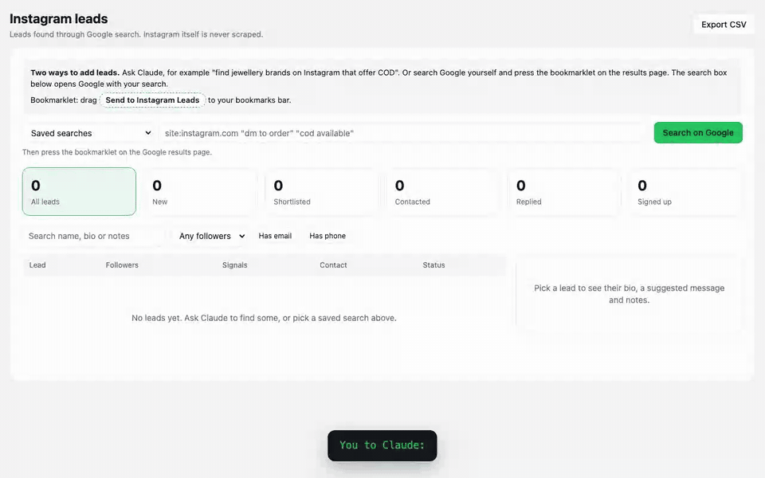
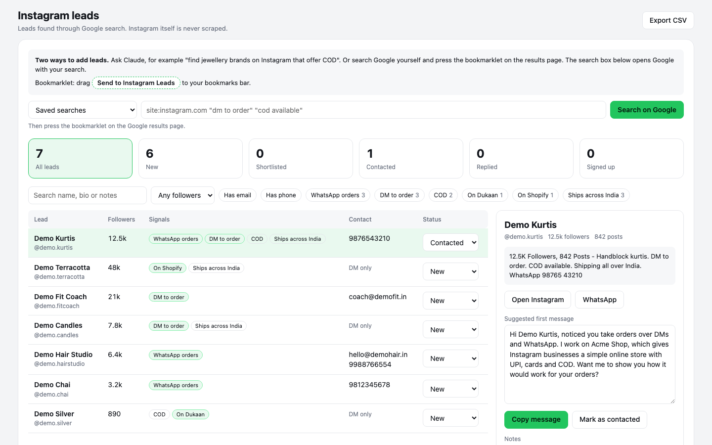

# Instagram leads skill

A Claude Code skill, plus a small local tool, for finding business leads on Instagram. It finds public Instagram profiles in Google results, reads the bio text Google shows for each one, and tags each lead by what the bio says: orders over DMs or WhatsApp, a Shopify or Dukaan store, cash on delivery, an email or phone number. You review the leads in a local web page, keep notes and statuses, and copy a suggested first message.

It never logs in to Instagram or Facebook, never scrapes them, and never sends messages for you. No API key is needed.

It works for any business you can describe in a search: shops, salons, coaches, cafes. The default searches and messages target online shops in India. Change the country, searches and messages in two JSON files (see [Customise](#customise)).



## How it finds leads

| Way | How it works | Results |
|---|---|---|
| Ask Claude (default) | Claude searches the web for Instagram profiles and saves what it finds | A few profiles per search, so Claude runs several searches |
| Bookmarklet | You search Google yourself and press a bookmark on the results page | Everything on the results page you are looking at, including follower counts |

Both read public search results, and neither opens Instagram.

## Requirements

- [Claude Code](https://docs.claude.com/en/docs/claude-code), for the skill. The review page and the bookmarklet also work without it.
- Node.js 22 or newer.

## Install

### Option 1: Claude Code plugin

Inside Claude Code:

```
/plugin marketplace add dev-ashishk/instagram-leads-skill
/plugin install social-leads-finder@social-leads-finder
```

Restart Claude Code after installing. `/plugin marketplace update social-leads-finder` fetches new versions.

### Option 2: Clone and link

```bash
git clone https://github.com/dev-ashishk/instagram-leads-skill.git ~/instagram-leads-skill
mkdir -p ~/.claude/skills
ln -s ~/instagram-leads-skill/skills/instagram-leads ~/.claude/skills/instagram-leads
```

`git pull` in the clone updates the skill.

## Using the skill

A skill is a set of instructions Claude Code loads when your request matches it. This one tells Claude how to start the tool, search for leads, save them and update them, so you only describe what you want.

### Start it

Ask in plain words inside Claude Code, in any project:

```
find jewellery brands on Instagram that offer COD
```

Claude recognises the request and loads the skill. You can also call it by name:

```
/instagram-leads find salons in Pune with an email in their bio
```

If you installed it as a plugin, the full name is `/social-leads-finder:instagram-leads`.

### First run

The first time, Claude asks two things: what you sell, and one line on what it does for your leads. It saves them in `~/.instagram-leads/config.json` and uses them to fill in the suggested messages. Then it starts the review page at http://localhost:5600 and opens it.

### Things to ask

| You say | Claude does |
|---|---|
| "Find handmade candle brands that ship across India" | Runs several searches and saves the leads it finds |
| "Show me the ones with more than 5k followers that take WhatsApp orders" | Filters your saved leads and lists them |
| "Shortlist the leads on Shopify and draft a message for each" | Sets their status and writes a message per lead |
| "Mark @demo.kurtis as contacted, follow up Friday" | Updates the status and notes |
| "Which searches found the most new leads?" | Reads the search history |
| "Export my leads to a CSV" | Saves a CSV file |
| "Stop the leads tool" | Stops the local server |

Claude can draft messages, but it never sends them. You copy each one and send it yourself from Instagram.

## Use the bookmarklet

The bookmarklet sends the Instagram results from a Google results page to the tool, with no key and no account.

1. Start the tool (ask Claude, or run `node skills/instagram-leads/tool/server.mjs`) and open http://localhost:5600.
2. Drag **Send to Instagram Leads** from the top of the page to your bookmarks bar.
3. Search Google, for example `site:instagram.com "dm to order" "cod available" kurti`. The search box on the review page opens Google with your search.
4. On the results page, press the bookmark. A tab opens on the review page with the results.
5. Press **Save to leads**, or **Discard**.

Press it once for each results page you want. It only reads the page you are looking at, and it works only while the tool is running.

## Use the tool on its own

```bash
node skills/instagram-leads/tool/server.mjs
```

Open http://localhost:5600 and add leads with the bookmarklet.



On the review page:

1. Filter by signal, follower count, or whether the lead lists an email or phone.
2. Click a lead to see their bio and a suggested first message. Copy it, edit it and send it yourself.
3. Set a status (Shortlisted, Contacted, Replied, Signed up, Not a fit) and add notes.
4. **Export CSV** downloads everything.

The same actions are available over HTTP:

```bash
# Save search results you collected yourself (each needs link, title, snippet)
curl -s localhost:5600/api/import -H 'Content-Type: application/json' \
  -d '{"source":"manual","query":"kurti cod","results":[{"link":"https://www.instagram.com/<handle>/","title":"...","snippet":"..."}]}'

# All leads, recent searches and settings
curl -s localhost:5600/api/state

# Update a lead
curl -s -X PATCH localhost:5600/api/leads/<handle> -H 'Content-Type: application/json' \
  -d '{"status":"contacted","notes":"Follow up Friday"}'

# Download a CSV
curl -s localhost:5600/api/export.csv -o leads.csv
```

Set `PORT` to run on a port other than 5600. The bookmarklet uses the port the page was open on when you dragged it.

## What it saves and where

Each search goes to the service that runs it: Claude's web search, or Google in your browser. The review page itself makes no outside requests. Everything else stays on your machine, in `~/.instagram-leads/` (or the folder in `INSTAGRAM_LEADS_HOME`):

| File | What it holds |
|---|---|
| `leads.json` | Every lead found, with your statuses and notes |
| `config.json` | Your product, pitch, country and messages |
| `queries.json` | Optional. Your own saved searches |

Searching again updates leads you already have and keeps your statuses and notes. Updating or reinstalling the skill does not touch this folder.

## Customise

Copy the bundled files into `~/.instagram-leads/` and edit the copies:

```bash
mkdir -p ~/.instagram-leads
cp skills/instagram-leads/tool/config.json skills/instagram-leads/tool/queries.json ~/.instagram-leads/
```

`config.json` holds:
- `product`: your product's name.
- `pitch`: a clause that finishes "I work on {product}, which ...".
- `country`: the Google country code the search box uses (`in`, `us`, `gb` and so on).
- `messages`: four templates, picked by the lead's strongest signal: `shopify`, `store` (Dukaan or another store), `chat` (DMs or WhatsApp), and `default`. Templates can use `{name}`, `{product}`, `{pitch}` and `{channels}`.

`queries.json` is a list of saved searches, each with a `label` and a `query`.

The bio parser, including the Indian phone number format, is in `skills/instagram-leads/tool/server.mjs`. Run `node skills/instagram-leads/tool/test.mjs` after changing it.

## Security

- The server listens on 127.0.0.1 only, so other machines can't reach it.
- It rejects requests from other websites, so a page you visit can't read or change your leads. It does this by checking the `Host` and `Origin` headers and accepting writes only as JSON.
- The review page runs only its own script (Content Security Policy). Bio text from search results is escaped before it's shown.
- Bookmarklet results wait for you to press **Save to leads**.
- `leads.json` is readable only by your user account. The CSV export defuses spreadsheet formulas in bios.
- The tool has no dependencies, so there are no third-party packages to audit.

To report a vulnerability, see [SECURITY.md](SECURITY.md).

## Outreach rules

- Send every message yourself. Keep Instagram DMs to about 20 to 30 a day.
- Don't send cold WhatsApp template messages. Meta bans numbers for it.
- Keep only what leads published for their business. If someone says no, mark them Not a fit and don't contact them again.
- Check the privacy and marketing laws where you and your leads are, such as India's DPDP Act or GDPR.

## License

MIT
